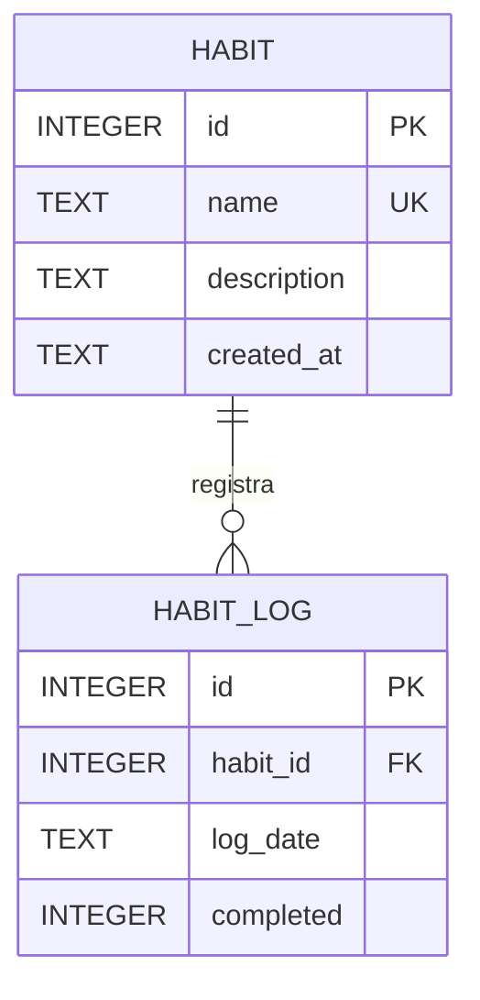

# Diagrama entidad relación

**Cardinalidad:** un hábito puede tener cero o muchos registros diarios; cada registro pertenece a un solo hábito. La combinación `habit_id` + `log_date` es única para permitir como máximo un estado diario por hábito. Al eliminar un hábito se elimina su historial.
